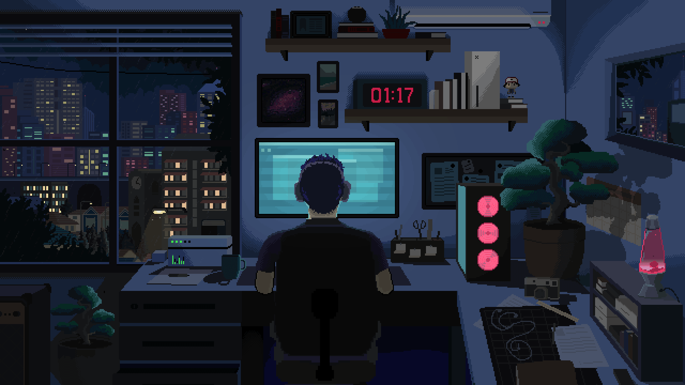

<!-- ═════════════════════ HEADER ═════════════════════ -->
<div align="center">


</div>
<br/>

<div align="center">


<br/>

### `AI/ML Developer  •  Software Engineer  •  Lifelong Learner`

<br/>

<a href="https://linkedin.com/in/vikas-kajeepeta-8586743a8">
  
</a>
<a href="mailto:vikaskajeepeta2005@gmail.com">
  
</a>
<a href="https://github.com/VikasKajeepeta2005">
  
</a>

</div>

<br/>

<!-- ═════════════════════ ABOUT ═════════════════════ -->

## `~/about`

```json
{
  "name": "Vikas Kajeepeta",
  "role": "AI & Machine Learning Developer",
  "education": "B.Tech CSE - AI & ML",
  "location": "India",
  "interests": [
    "Artificial Intelligence",
    "Machine Learning",
    "Deep Learning",
    "Computer Vision",
    "Generative AI"
  ],
  "goal": "Building intelligent real-world solutions",
  "open_to": [
    "Internships",
    "Collaborations",
    "Open Source"
  ],
  "mantra": "learn continuously. build intelligently."
}
```

<br/>

<!-- ═════════════════════ STACK ═════════════════════ -->

## `~/stack`

<div align="center">

### Languages


### AI / ML & Data Science


### Development Tools


</div>

<br/>

<!-- ═════════════════════ NOW ═════════════════════ -->

## `~/now`

```diff
+ Learning    → Advanced AI/ML & Deep Learning
+ Exploring   → Generative AI and Computer Vision
+ Practicing  → Data Structures & Algorithms
+ Building    → Practical software and AI projects
+ Preparing  → GATE CS 2027
```

<br/>

<!-- ═════════════════════ FOCUS ═════════════════════ -->

## `~/interests`

- Artificial Intelligence & Machine Learning
- Deep Learning and Neural Networks
- Computer Vision
- Generative AI and LLMs
- Software Development
- Open Source Contributions

<br/>

<!-- ═════════════════════ STATS ═════════════════════ -->

## `~/stats`

<div align="center">


<br/><br/>


</div>

<br/>

<!-- ═════════════════════ ACTIVITY ═════════════════════ -->

## `~/activity`

<div align="center">


</div>

<br/>

<!-- ═════════════════════ FOOTER ═════════════════════ -->

<div align="center">

### `while(alive) { learn(); build(); repeat(); }`


</div>

